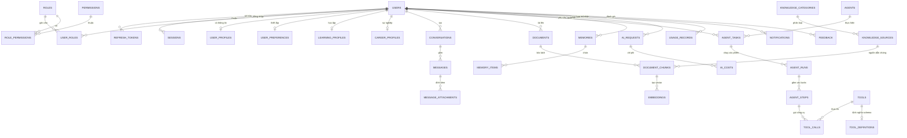

# THIẾT KẾ CƠ SỞ DỮ LIỆU & SƠ ĐỒ ERD (DATABASE DESIGN & ERD)

**Dự án:** VietAI Life Platform  
**Hệ quản trị CSDL:** Microsoft SQL Server / PostgreSQL + pgvector  
**Chuẩn thiết kế:** 3NF / BCNF, Production-Ready, Soft Delete, Auditing, Concurrency Versioning  

---

## 1. Bản đồ tổng quan các phân hệ CSDL (36 Bảng nghiệp vụ)

Hệ thống được chia thành 8 phân hệ bảng độc lập và liên kết chặt chẽ:

```
┌────────────────────────────────────────────────────────────────────────┐
│ 1. IDENTITY & RBAC: Users, Roles, Permissions, UserRoles,              │
│    RolePermissions, UserProfiles, RefreshTokens, Sessions, ApiKeys     │
├────────────────────────────────────────────────────────────────────────┤
│ 2. CHAT & CONVERSATION: Conversations, Messages, MessageAttachments    │
├────────────────────────────────────────────────────────────────────────┤
│ 3. KNOWLEDGE & RAG: Documents, DocumentChunks, KnowledgeSources,       │
│    KnowledgeCategories, Embeddings                                     │
├────────────────────────────────────────────────────────────────────────┤
│ 4. AGENT ENGINE: Agents, AgentTasks, AgentRuns, AgentSteps             │
├────────────────────────────────────────────────────────────────────────┤
│ 5. TOOL SYSTEM: Tools, ToolDefinitions, ToolCalls                      │
├────────────────────────────────────────────────────────────────────────┤
│ 6. MEMORY & PREFERENCES: Memories, MemoryItems, UserPreferences        │
├────────────────────────────────────────────────────────────────────────┤
│ 7. DOMAIN VERTICALS: LearningProfiles, CareerProfiles                  │
├────────────────────────────────────────────────────────────────────────┤
│ 8. SYSTEM & AUDIT: Notifications, Feedback, AuditLogs, UsageRecords,   │
│    AiRequests, AiCosts, SystemSettings                                 │
└────────────────────────────────────────────────────────────────────────┘
```

---

## 2. Sơ đồ thực thể liên kết (Mermaid ERD)



---

## 3. Chi tiết đặc tả các bảng dữ liệu cốt lõi

Mỗi bảng trong hệ thống đều tuân thủ nghiêm ngặt các quy ước chung:
* `Id` (GUID / UUIDv7) làm **Primary Key (PK)**.
* `CreatedAt`, `UpdatedAt` (DateTimeOffset UTC) cho kiểm toán thời gian.
* `IsDeleted` (Boolean) + `DeletedAt` cho cơ chế **Soft Delete**.
* `RowVersion` (byte[] / timestamp) để kiểm soát tương tranh lạc quan (**Optimistic Concurrency**).

---

### Phân hệ 1: Identity & Authentication

#### 1. `Users`
* `Id` (Guid, PK)
* `Email` (nvarchar(256), NOT NULL, UNIQUE)
* `PasswordHash` (nvarchar(512), NOT NULL)
* `SecurityStamp` (nvarchar(256), NOT NULL)
* `IsEmailConfirmed` (bit, NOT NULL, DEFAULT 0)
* `Status` (int, NOT NULL, DEFAULT 1) — 1: Active, 2: Locked, 3: Suspended
* `CreatedAt`, `UpdatedAt`, `IsDeleted`, `RowVersion`
* **Index:** `IX_Users_Email` (Unique, Filtered: `IsDeleted = 0`)

#### 2. `Roles` & `Permissions`
* `Roles (Id, Name, NormalizedName, Description)`
* `Permissions (Id, Code, Module, Description)`
* `UserRoles (UserId, RoleId)` — PK: `(UserId, RoleId)`
* `RolePermissions (RoleId, PermissionId)` — PK: `(RoleId, PermissionId)`

#### 3. `RefreshTokens` & `Sessions`
* `RefreshTokens (Id, UserId, TokenHash, ExpiresAt, IsRevoked, CreatedByIp, ReplacedByToken)`
* `Sessions (Id, UserId, DeviceInfo, IpAddress, LastActivityAt, IsActive)`

---

### Phân hệ 2: Hội thoại & Tin nhắn (Chat & Conversation)

#### 4. `Conversations`
* `Id` (Guid, PK)
* `UserId` (Guid, FK $\rightarrow$ `Users.Id`, NOT NULL)
* `Title` (nvarchar(255), NOT NULL)
* `Summary` (nvarchar(1000), NULL)
* `ModelUsed` (nvarchar(100), NOT NULL)
* `Pinned` (bit, NOT NULL, DEFAULT 0)
* `CreatedAt`, `UpdatedAt`, `IsDeleted`
* **Index:** `IX_Conversations_UserId_UpdatedAt`

#### 5. `Messages`
* `Id` (Guid, PK)
* `ConversationId` (Guid, FK $\rightarrow$ `Conversations.Id`, NOT NULL)
* `Role` (nvarchar(50), NOT NULL) — 'user', 'assistant', 'system', 'tool'
* `Content` (nvarchar(MAX), NOT NULL)
* `ThoughtProcess` (nvarchar(MAX), NULL) — Reasoning Chain / CoT
* `TrustLevel` (int, NOT NULL, DEFAULT 0) — 0: Unspecified, 1: Fact, 2: Inference, 3: Opinion, 4: Uncertain
* `TokenCount` (int, NOT NULL, DEFAULT 0)
* `CreatedAt`
* **Index:** `IX_Messages_ConversationId_CreatedAt`

#### 6. `MessageAttachments`
* `Id` (Guid, PK)
* `MessageId` (Guid, FK $\rightarrow$ `Messages.Id`, NOT NULL)
* `FileName` (nvarchar(255), NOT NULL)
* `FileType` (nvarchar(100), NOT NULL)
* `StorageUrl` (nvarchar(1000), NOT NULL)
* `FileSize` (bigint, NOT NULL)

---

### Phân hệ 3: Tri thức & RAG Pipeline

#### 7. `Documents`
* `Id` (Guid, PK)
* `UserId` (Guid, FK $\rightarrow$ `Users.Id`, NULL nếu là Tri thức công khai)
* `Title` (nvarchar(255), NOT NULL)
* `SourceUrl` (nvarchar(1000), NULL)
* `FileStoragePath` (nvarchar(1000), NOT NULL)
* `MimeType` (nvarchar(100), NOT NULL)
* `FileSizeBytes` (bigint, NOT NULL)
* `ProcessingStatus` (int, NOT NULL) — 0: Queued, 1: Processing, 2: Ready, 3: Failed
* `ErrorMessage` (nvarchar(MAX), NULL)
* `TrustLevel` (int, NOT NULL, DEFAULT 1)

#### 8. `DocumentChunks`
* `Id` (Guid, PK)
* `DocumentId` (Guid, FK $\rightarrow$ `Documents.Id`, NOT NULL)
* `ChunkIndex` (int, NOT NULL)
* `Content` (nvarchar(MAX), NOT NULL)
* `PageNumber` (int, NULL)
* `TokenLength` (int, NOT NULL)
* `MetadataJson` (nvarchar(MAX), NULL)
* **Index:** `IX_DocumentChunks_DocumentId_ChunkIndex`

#### 9. `Embeddings`
* `Id` (Guid, PK)
* `ChunkId` (Guid, FK $\rightarrow$ `DocumentChunks.Id`, NOT NULL)
* `ModelName` (nvarchar(100), NOT NULL)
* `VectorDimensions` (int, NOT NULL) — Ví dụ: 1536 (OpenAI), 768 (Gemini/BGE)
* `VectorData` (varbinary(MAX) hoặc vector column trong PostgreSQL pgvector)

#### 10. `KnowledgeSources` & `KnowledgeCategories`
* `KnowledgeCategories (Id, Name, Slug, Description)`
* `KnowledgeSources (Id, CategoryId, Name, Organization, BaseUrl, VerificationStatus, LastCrawledAt)`

---

### Phân hệ 4 & 5: AI Agent & Công cụ (Tools)

#### 11. `Agents` & `AgentTasks`
* `Agents (Id, Name, Description, SystemPrompt, CapabilityFlags, IsSystem)`
* `AgentTasks (Id, UserId, AgentId, Title, GoalDescription, Status, CreatedAt, FinishedAt)`
  * *Status:* 0: Pending, 1: Planning, 2: Executing, 3: AwaitingApproval, 4: Succeeded, 5: Failed, 6: Cancelled

#### 12. `AgentRuns` & `AgentSteps`
* `AgentRuns (Id, TaskId, RunNumber, StartTime, EndTime, TotalSteps, Status)`
* `AgentSteps (Id, RunId, StepNumber, StepType, ActionDetails, Observation, ExecutionTimeMs, Status)`

#### 13. `Tools`, `ToolDefinitions`, `ToolCalls`
* `Tools (Id, Name, Category, PermissionRequired, IsEnabled)`
* `ToolDefinitions (Id, ToolId, JsonSchema, Description, Version)`
* `ToolCalls (Id, StepId, ToolId, InputParametersJson, OutputResultJson, IsSuccess, ErrorDetails)`

---

### Phân hệ 6 & 7: Bộ nhớ & Chuyên ngành (Memory & Verticals)

#### 14. `Memories` & `MemoryItems`
* `Memories (Id, UserId, MemoryType, Title, IsActive)`
* `MemoryItems (Id, MemoryId, Key, Value, ConfidenceScore, LastAccessedAt)`

#### 15. `LearningProfiles` & `CareerProfiles`
* `LearningProfiles (Id, UserId, CurrentLevel, TargetExam, TargetDeadline, WeeklyHours)`
* `CareerProfiles (Id, UserId, CurrentRole, TargetRole, SkillsJson, PortfolioUrl, ResumeUrl)`

---

### Phân hệ 8: Giám sát, Chi phí & Kiểm toán (System, Cost & Audit)

#### 16. `AiRequests` & `AiCosts`
* `AiRequests (Id, UserId, ModelName, PromptTokens, CompletionTokens, TotalTokens, LatencyMs, StatusCode, TraceId)`
* `AiCosts (Id, RequestId, EstimatedCostUsd, EstimatedCostVnd, PricingTier)`

#### 17. `AuditLogs`
* `AuditLogs (Id, UserId, Action, EntityName, EntityId, OldValuesJson, NewValuesJson, IpAddress, UserAgent, Timestamp)`

#### 18. `SystemSettings`
* `SystemSettings (Key, Value, DataType, Category, Description, IsEncrypted, UpdatedAt)`
